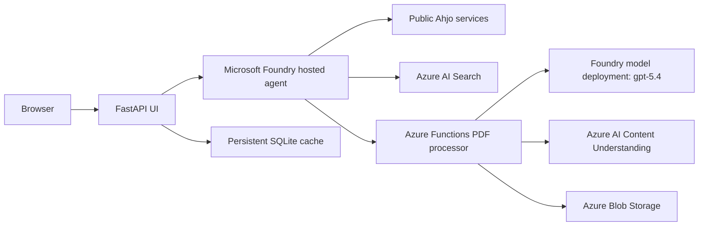

# Ahjo Meeting Agent

Web application for reviewing Helsinki meeting agendas and attachments. It can summarize published material, identify contradictions, and relate items to the Helsinki City Strategy 2025-2029.

## Architecture



The hosted agent runs on Microsoft Agent Framework and exposes the Responses protocol. It selects Ahjo, attachment-processing, and strategy-search tools based on the request.

The PDF processor downloads published attachments and extracts text with `pdfplumber`. It uses Azure AI Content Understanding when direct extraction is insufficient. Documents up to 1,500 estimated tokens are returned as extracted text; larger documents are split into chunks of at most 12,000 estimated tokens and summarized with `gpt-5.4`. Processed attachment content and job state are stored in Azure Blob Storage. The single-instance UI uses persistent SQLite under App Service `/home`.

## Run Locally

Prerequisites: Python 3.13, Azure CLI, access to the deployed Foundry project and PDF processor.

```powershell
az login
$env:AGENT_ENDPOINT = "<Foundry hosted agent Responses endpoint>"
$env:PDF_PROCESSOR_URL = "<PDF processor Function App URL>"
$env:PDF_PROCESSOR_KEY = "<Function key>"

python -m venv .venv
.\.venv\Scripts\Activate.ps1
python -m pip install -r .\ui\requirements.txt
Set-Location .\ui
python -m uvicorn app:app --host 127.0.0.1 --port 8000
```

Open `http://127.0.0.1:8000`.

## Deploy

Infrastructure is defined in `infra/`. The hosted agent is deployed with:

```powershell
$env:AZD_SKIP_FIRST_RUN = "true"
azd deploy ahjo-meetings --no-prompt
```

The PDF processor is deployed separately as an Azure Function from `src/pdf-processor/`.

The UI deploys to a single Linux B1 App Service with Microsoft Entra authentication and managed identity. Set `ENABLE_UI=true`, `UI_ENTRA_CLIENT_ID`, `UI_ENTRA_CLIENT_SECRET`, `AGENT_ENDPOINT`, `PDF_PROCESSOR_URL`, and `PDF_PROCESSOR_KEY` in the azd environment before provisioning.

## License

MIT